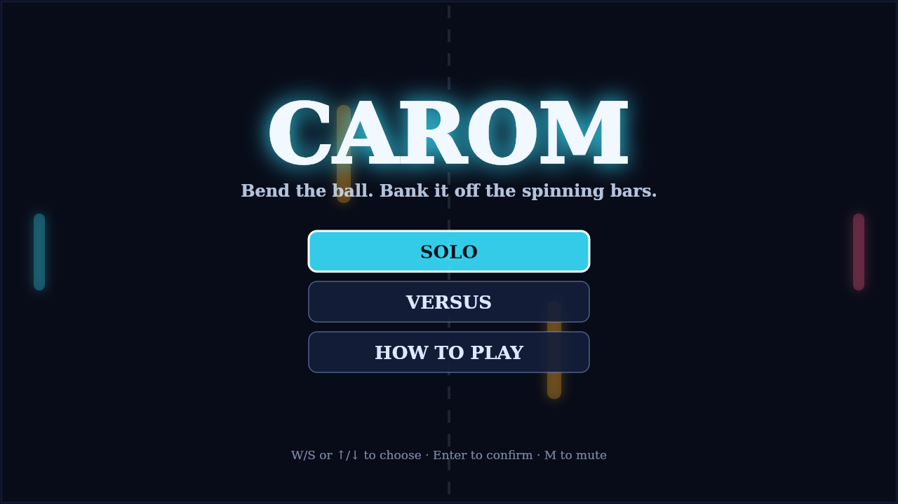
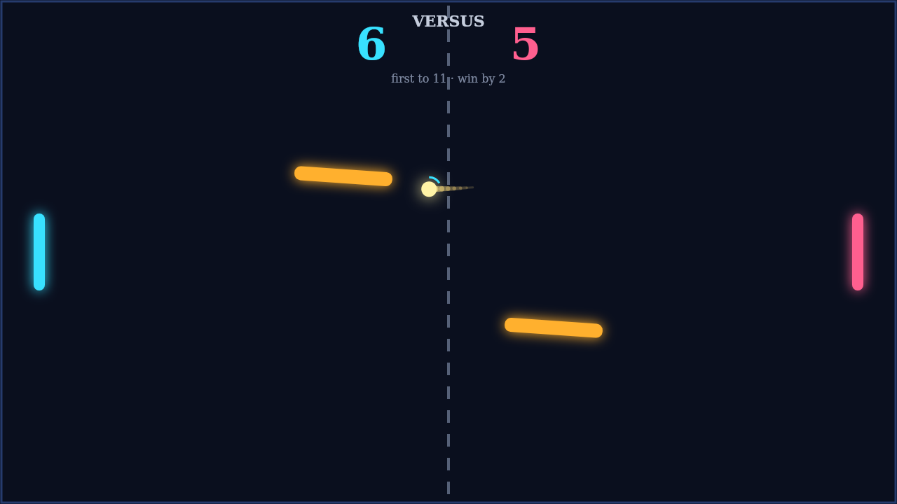
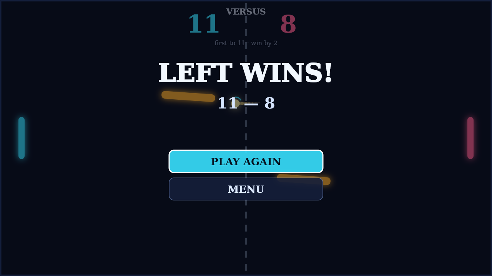

# Carom

Carom is a top-down paddle duel on a dark, neon field. You guard the left edge,
your rival guards the right, and a single ball ricochets between you — off the
walls, off your paddles, and off the two amber bars that sway and spin in the
middle of the field. Slip the ball past the far paddle to score; first to
eleven, with a two-point lead, wins the match.

A rally in Carom is never a straight line for long. Strike the ball while your
paddle is moving and you load it with spin: a paddle sweeping downward sends
the shot curving clockwise, one sweeping upward bends it the other way, and
the curve holds as the ball flies, fading only gradually. Feather a return so
it arcs around a defender, or drive a flat shot straight down the middle —
every contact is a chance to shape the next one.

The obstacles turn defence into a geometry problem. The two bars drift up and
down in opposition and rotate without pause, so the angle that saved you a
second ago now opens a lane behind you. Bank a spinning shot off a tilted face
to wrong-foot your opponent, thread the narrowing gap between the bars, or
use them as a screen and let the ball emerge somewhere nobody is standing.

Play Solo against an AI that reads the ball's flight and hurries home when the
attack is yours, or hand the right side of the keyboard to a friend in Versus
and settle it locally. Either way, matches swing on the last few rallies:
deuce at ten-all, and no winner until somebody strings two points together.

